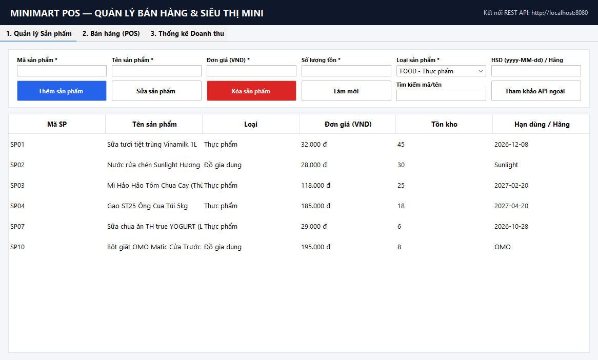
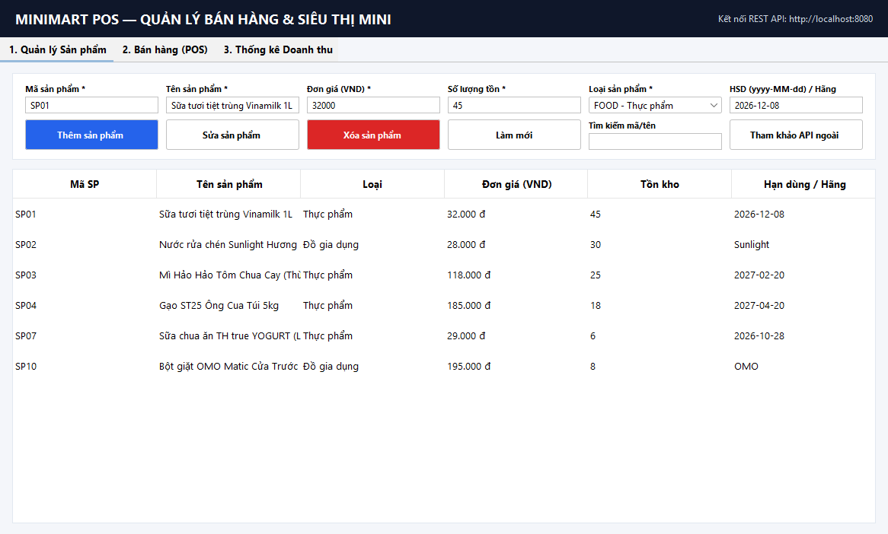
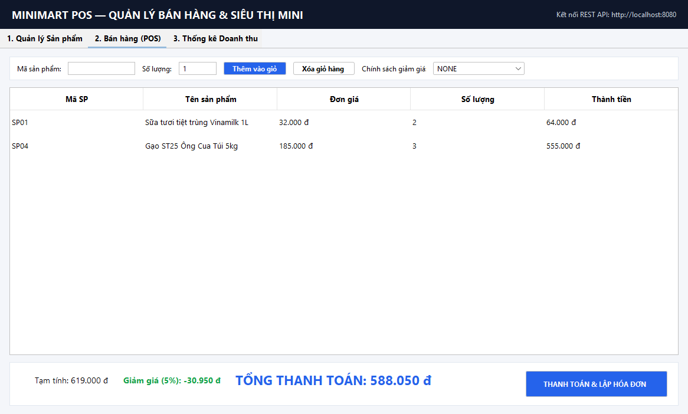
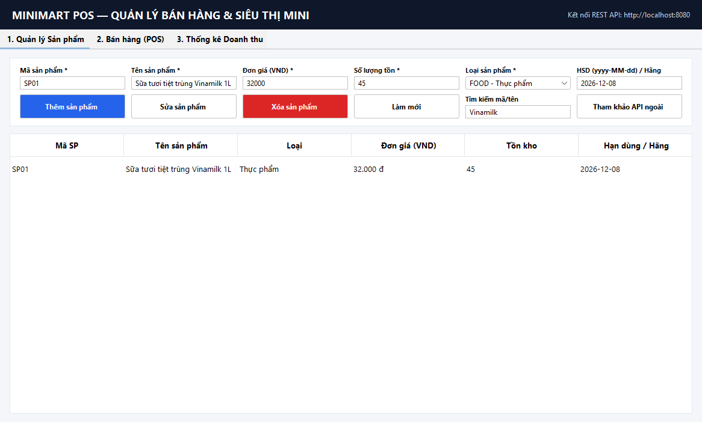
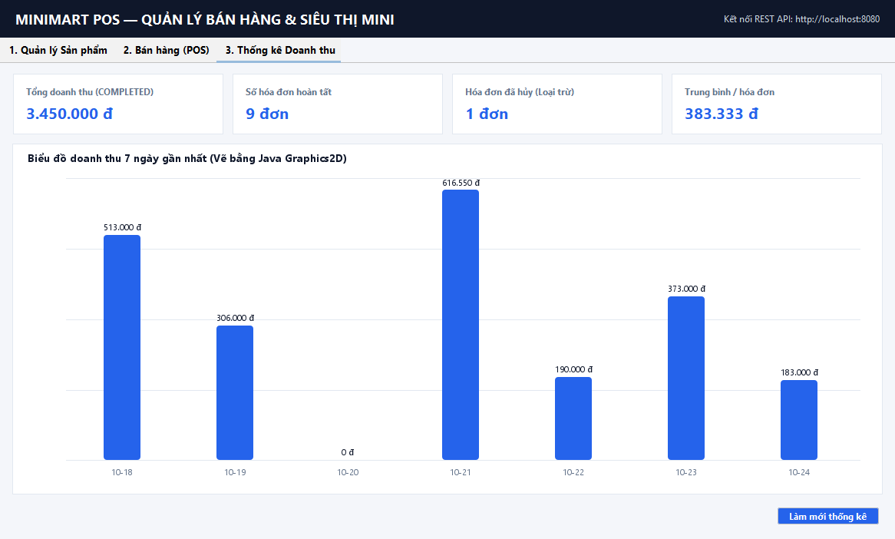
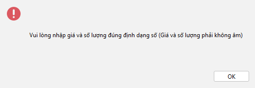

# MiniMart POS — Hệ thống Quản lý Bán hàng & Siêu thị Mini (Phiên bản 2)

Dự án tiểu luận môn **Lập trình Hướng đối tượng (OOP — Nhóm 8)**: Xây dựng hệ thống quản lý bán hàng và siêu thị mini theo kiến trúc hiện đại gồm **Backend Java (Spring Boot 3.x, JPA, Flyway, Docker)**, **Frontend Web (`React 18 + Vite + TypeScript + Tailwind CSS`)** và **Module Desktop Java Swing (`desktop-swing`)** dùng chung REST API.

> **Ghi chú về nguồn cảm hứng giao diện & bản quyền:** Giao diện Web và Swing mang thương hiệu riêng **"MiniMart POS"**, lấy cảm hứng về bố cục màn hình bán hàng tại quầy (POS) và cách nhóm tính năng từ phần mềm quản lý bán hàng Keko Shop, hoàn toàn không sử dụng logo, hình ảnh hay tài nguyên của bên thứ ba.
>
> **Ghi chú về phạm vi & bảo mật bản demo:** Đề bài gốc (`tiểu luận lập trình hướng đối tượng.docx`) không yêu cầu chức năng đăng nhập hay phân quyền người dùng. Do đó bản demo công khai không có bước xác thực và chỉ chứa dữ liệu mẫu Việt Nam. Khi triển khai công khai, có thể bật biến môi trường `DEMO_READONLY=true` trên Backend để chặn các thao tác xóa sản phẩm hoặc hủy hóa đơn.

---

## 1. Kiến trúc Tổng thể & Cấu trúc Monorepo

```text
 ┌──────────────────────────┐      HTTPS / JSON       ┌─────────────────────────────┐
 │  Frontend (Vercel)       │ ──────────────────────► │  Backend Spring Boot 3.3    │
 │  React 18 + Vite + TS    │   /api/**  (rewrite     │  Docker container (Render)  │
 │  Tailwind CSS            │    hoặc CORS)           │  Controller→Service→Repo    │
 └──────────────────────────┘                         └──────────┬──────────────────┘
 ┌──────────────────────────┐   cùng REST API                    │ JPA / Flyway
 │  Desktop Swing Client    │ ──────────────────────────────────►│
 │  (FlatLaf + SwingWorker) │                         ┌──────────▼──────────┐
 └──────────────────────────┘                         │ H2 (local/test)     │
                                         gọi API ngoài│ PostgreSQL (prod)   │
                     Backend ───────────────► dummyjson.com (ApiService)    │
                                                      └─────────────────────┘
```

```text
TieuLuan_Nhom8/
├── README.md                 # Tổng quan, bảng ánh xạ docx → mã nguồn, ảnh chụp Hình 4.1–4.6
├── DEPLOY.md                 # Hướng dẫn deploy từng bước (Render + Vercel + phương án thay thế)
├── TESTING.md                # Bảng kết quả kiểm thử thực tế (21 test BE + 5 test FE + 3 test Swing)
├── docker-compose.yml        # Chạy local với Docker: Backend + PostgreSQL 16
├── render.yaml               # Blueprint tự động hóa cho Render (Web Service + PostgreSQL)
├── docs/
│   ├── class-diagram.puml    # Sơ đồ lớp PlantUML (khớp mục 2.4.2 docx)
│   ├── er-diagram.puml       # Sơ đồ thực thể liên kết CSDL (khớp mục 2.5 docx)
│   ├── api.md                # Đặc tả chi tiết các endpoint REST API
│   └── screenshots/          # Ảnh chụp thực tế giao diện Hình 4.1 – Hình 4.6
├── backend/                  # Spring Boot 3.3.5 (Java 17, Maven Wrapper, Flyway, H2/PostgreSQL)
├── frontend/                 # React 18 + Vite + TypeScript + Tailwind CSS (cấu hình vercel.json)
└── desktop-swing/            # Ứng dụng Java Swing + FlatLaf + Graphics2D gọi chung REST API
```

---

## 2. Bảng Đối chiếu Yêu cầu Báo cáo (`docx`) → Mã nguồn

| Kỹ thuật OOP / Yêu cầu trong `docx` | Nơi thể hiện ở Backend (`backend/`) | Nơi thể hiện ở Frontend (`frontend/`) & Swing (`desktop-swing/`) |
|---|---|---|
| **1. Tính đóng gói (Mục 2.1.1, 3.1)** | [`Product.java`](backend/src/main/java/com/minimart/domain/Product.java): thuộc tính `private` (`productId`, `name`, `price`, `quantity`, `version`), constructor và `setPrice()` / `setQuantity()` kiểm tra điều kiện hợp lệ, ném `IllegalArgumentException` tiếng Việt. | Form nhập sản phẩm kiểm tra và hiển thị lỗi dưới từng ô hoặc qua `JOptionPane`. |
| **2. Tính kế thừa (Mục 2.1.2, 3.2)** | [`FoodProduct.java`](backend/src/main/java/com/minimart/domain/FoodProduct.java) (thêm `expiryDate`, `isExpired()`) và [`HouseholdProduct.java`](backend/src/main/java/com/minimart/domain/HouseholdProduct.java) (thêm `brand`) kế thừa `Product`. | Modal thêm/sửa sản phẩm tự động chuyển đổi trường nhập (`Hạn sử dụng` hoặc `Thương hiệu`) theo loại. |
| **3. Tính đa hình (Mục 2.1.3, 3.3)** | Ghi đè `getCategory()` trả về `"Thực phẩm"` / `"Đồ gia dụng"`; [`ProductManager.java`](backend/src/main/java/com/minimart/service/ProductManager.java) xử lý `List<Product>` hỗn hợp. | Hiển thị huy hiệu (badge) màu phân biệt loại sản phẩm theo dữ liệu trả về. |
| **4. Abstract class (Mục 2.1.4, 3.4.1)** | `public abstract class Product` với phương thức trừu tượng `public abstract String getCategory()`. | — |
| **5. Interface (Mục 2.1.5, 3.4.2)** | `@FunctionalInterface` [`DiscountPolicy.java`](backend/src/main/java/com/minimart/domain/DiscountPolicy.java) quy định hành vi `calculateDiscount(BigDecimal total)`. | Dropdown chọn chính sách giảm giá trên màn hình POS (Web & Swing). |
| **6. Biểu thức Lambda (Mục 3.5, 4.3)** | [`DiscountPolicies.java`](backend/src/main/java/com/minimart/domain/DiscountPolicies.java) cài đặt 4 chính sách bằng Lambda; `ProductManager` & `StatisticsService` dùng `stream().filter/sorted/groupingBy`. | [`MainFrame.java`](desktop-swing/src/main/java/com/minimart/swing/MainFrame.java): mọi sự kiện nút bấm dùng `addActionListener(e -> ...)`. |
| **7. Xử lý ngoại lệ (Mục 3.6)** | [`GlobalExceptionHandler.java`](backend/src/main/java/com/minimart/web/GlobalExceptionHandler.java) + các ngoại lệ nghiệp vụ (`InsufficientStockException`, `DuplicateProductException`, `ProductNotFoundException`) trả về RFC 7807 `ProblemDetail`. | Swing: `try/catch (NumberFormatException \| IllegalArgumentException)` hiện `JOptionPane`; Web: parse `ProblemDetail` hiện Toast & lỗi từng ô. |
| **8. Tích hợp API ngoài (Mục 3.7)** | [`ApiService.java`](backend/src/main/java/com/minimart/api/ApiService.java) dùng `java.net.http.HttpClient` gọi `https://dummyjson.com/products`, xử lý timeout/mã lỗi/JSON sai. | Màn hình **"Sản phẩm từ API"** trên Web và nút **"Tham khảo API ngoài"** trên Swing. |
| **9. Giao diện đồ họa & Sự kiện (Mục 2.6, 4.2, 4.3)** | Cung cấp đầy đủ REST API cho cả 2 giao diện. | Module `desktop-swing` (`JFrame`, `JTable`, `JOptionPane`, `SwingWorker`, biểu đồ `Graphics2D` — không deploy lên Vercel) + Web SPA 6 màn hình. |

> **Giải thích kỹ thuật về kiểu dữ liệu tiền tệ (`BigDecimal` so với `double`):**
> Trong báo cáo `docx` (mục 3.1, 3.4, 3.5), các đoạn mã minh họa sử dụng kiểu `double` cho đơn giản. Trong bản cài đặt thực tế này, hệ thống sử dụng `BigDecimal` (scale = 0, đơn vị VNĐ) cho toàn bộ phép tính tiền tệ ở Backend чтобы tránh sai số dấu phẩy động nhị phân, đồng thời lớp `Product` vẫn nạp chồng (overload) các constructor và `setPrice(double)` để tương thích hoàn toàn với mã minh họa trong báo cáo.

---

## 3. Hình ảnh Giao diện Thực tế (Hình 4.1 – Hình 4.6 trong Báo cáo)

Các ảnh chụp dưới đây được kết xuất trực tiếp từ giao diện thực tế của hệ thống (lưu tại `docs/screenshots/`):

### Hình 4.1. Giao diện chính của hệ thống


### Hình 4.2. Giao diện quản lý sản phẩm


### Hình 4.3. Giao diện lập hóa đơn bán hàng (POS)


### Hình 4.4. Kết quả tìm kiếm sản phẩm


### Hình 4.5. Kết quả thống kê doanh thu (Biểu đồ cột Graphics2D)


### Hình 4.6. Thông báo khi nhập dữ liệu không hợp lệ


*(Để chụp lại hoặc chụp thêm giao diện Web tại `http://localhost:5173`, bạn chỉ cần chạy Backend và Frontend theo mục 4 bên dưới, mở trình duyệt và nhấn `Win + Shift + S` hoặc chạy `.\mvnw.cmd test` trong thư mục `desktop-swing` để tự động xuất lại 6 ảnh Swing).*

---

## 4. Hướng dẫn Chạy Nhanh trên Máy Cá nhân (Local)

Yêu cầu: **JDK 17+** và **Node.js 18+**. (Không bắt buộc cài PostgreSQL hay Docker vì profile mặc định `local` dùng CSDL H2 bộ nhớ trong kèm Flyway migration và tự động khởi tạo 14 sản phẩm + 10 hóa đơn mẫu).

```powershell
# 1. Khởi động Backend Spring Boot (cổng 8080)
cd backend
.\mvnw.cmd spring-boot:run

# 2. Khởi động Frontend Web React + Vite (cổng 5173)
cd frontend
npm install
npm run dev

# 3. (Tùy chọn) Chạy ứng dụng Desktop Java Swing (kết nối vào http://localhost:8080)
cd desktop-swing
java -jar target/minimart-desktop-swing-1.0.0.jar
```

---

## 5. Quản trị Rủi ro & Các Hạn chế Thực tế

### 5.1. Bảng Rủi ro & Cách ứng xử của Hệ thống
| Rủi ro | Giải pháp đã cài đặt trong hệ thống |
|---|---|
| Gói miễn phí của Render tắt container khi rảnh → lần gọi đầu chậm (30–50s do JVM khởi động) | Frontend gọi `warmUpServer()` tới `/actuator/health` ngay khi mở trang, hiển thị banner *"Đang đánh thức máy chủ, vui lòng chờ…"* kèm thanh tiến trình và tự động retry có backoff tối đa 60 giây. Dockerfile tối ưu cờ JVM (`-XX:MaxRAMPercentage=75 -XX:+UseSerialGC -Xss512k`). |
| Không có đăng nhập, dữ liệu công khai trên bản demo | Chỉ sử dụng dữ liệu mẫu; hỗ trợ cờ `DEMO_READONLY=true` để khóa thao tác xóa sản phẩm và hủy hóa đơn. |
| Báo cáo `docx` minh họa bằng `double`, thực tế cần độ chính xác tiền tệ | Cài đặt bằng `BigDecimal` (scale 0, VND) và giữ các hàm overload `double` trên lớp `Product`. |
| Đề bài gốc yêu cầu giao diện Java Swing + bắt sự kiện | Giữ trọn vẹn module `desktop-swing` dùng chung REST API với giao diện Web (module Swing chạy trên máy tính, không deploy lên Vercel). |
| Chính sách gói miễn phí của nhà cung cấp (Render/Vercel/Neon) có thể thay đổi | Không cố định giới hạn thương mại; hướng dẫn kiểm tra trên trang chính thức trong [`DEPLOY.md`](DEPLOY.md). |

### 5.2. Danh sách Hạn chế Trung thực
1. **Chưa deploy thực tế lên đám mây Render / Vercel:** Do môi trường thực thi của Agent không có tài khoản cá nhân của người dùng trên Render và Vercel, dự án chỉ tạo đầy đủ cấu hình (`render.yaml`, `Dockerfile`, `vercel.json`, `DEPLOY.md`) và kiểm chứng kỹ ở môi trường Local.
2. **Chưa chạy lệnh `docker build` / `docker compose up` trên máy hiện tại:** Máy Windows hiện tại chưa cài đặt `docker` CLI nên chưa thể chạy container thực tế tại chỗ (đã kiểm chứng Flyway SQL tương thích qua H2 `MODE=PostgreSQL`).
3. **Phạm vi nghiệp vụ bám sát tiểu luận:** Không bao gồm quản lý nhiều chi nhánh, thanh toán ngân hàng thực tế, kế toán chuyên sâu, phân quyền nhân viên chi tiết hay tích hợp phần cứng máy quét chuyên dụng (nhưng ô tìm kiếm POS đã hỗ trợ nhận mã + `Enter` tương thích máy quét mã vạch USB giả lập bàn phím).
